# Experiment 04: Analyze Cache Coherence (MSI, MESI, MOESI) and NUMA Memory Access Performance

> Cache coherence protocols, false sharing and NUMA memory placement, studied with a protocol simulator and OpenMP benchmarks on an Ubuntu VMware guest.

## Table of Contents
1. [Objective](#1-objective)
2. [Software Requirements](#2-software-requirements)
3. [Theory](#3-theory)
4. [Cache Coherence and NUMA - Diagram](#4-cache-coherence-and-numa---diagram)
5. [Installation Steps (From Scratch)](#5-installation-steps-from-scratch)
6. [Programs and Compilation](#6-programs-and-compilation)
7. [Comparison Program - Scalability and Execution Time](#7-comparison-program---scalability--execution-time)
8. [Execution Steps (Terminal)](#8-execution-steps-terminal)
9. [Results](#9-results)
10. [Observation / Comparison Table](#10-observation--comparison-table)
11. [Conclusion](#11-conclusion)
12. [Experimental Notes and Limitations](#12-experimental-notes-and-limitations)
13. [Repository Structure](#13-repository-structure)

---

## 1. Objective

To study how cache coherence protocols (MSI, MESI and MOESI) keep the caches of a multi-core processor consistent, and to
evaluate the performance effect of coherence traffic (false sharing) and of NUMA memory placement (local vs remote memory).
One simple example is used throughout: **two threads, each incrementing its own counter, with the two counters placed either
on the same cache line or on separate cache lines**. The experiment measures correctness, execution time and scalability as
the number of threads increases.

## 2. Software Requirements

| S.No. | Software / Tool | Purpose |
|---|---|---|
| 1 | VMware Workstation Pro | Virtualization software to host the Ubuntu guest OS |
| 2 | Ubuntu 22.04 LTS (24.04 was used in this run) | Guest operating system used for compiling and running the programs |
| 3 | GCC Compiler (build-essential) | Compiles the C programs |
| 4 | OpenMP (libgomp, bundled with GCC) | Provides `#pragma omp` directives for parallel regions and timing (`omp_get_wtime`) |
| 5 | numactl and hwloc | Shows NUMA topology and binds threads and memory to a node (`numactl --cpunodebind`, `--membind`) |
| 6 | Python 3 | Runs the MSI / MESI / MOESI protocol simulator |
| 7 | Ubuntu Terminal | To compile and execute all programs and record timing results |

## 3. Theory

### 3.1 Why Cache Coherence is Needed
In a multi-core processor every core has its own private cache. If two cores load the same memory location, each holds its own
copy. When one core writes to its copy, the other core's copy becomes stale. Without coordination, the cores would see different
values for the same variable. A **cache coherence protocol** is the hardware mechanism that guarantees all cores see a single
consistent value for every memory location. In a **snooping** protocol, each cache watches (snoops) the shared bus or
interconnect and reacts to the reads and writes of the other caches.

### 3.2 Cache Line and False Sharing
Coherence is tracked per **cache line** (typically 64 bytes), not per variable. If two threads write to two different variables
that happen to lie on the same cache line, each write invalidates the other core's copy of the whole line, even though the
threads never touch each other's data. The line bounces back and forth between the cores. This is called **false sharing**. It
produces correct results but destroys performance and scalability. The usual fix is padding or alignment, so that each
thread's data sits on its own cache line.

### 3.3 MSI Protocol
MSI has three states per cache line: **Modified** (this cache has the only valid copy and it differs from memory), **Shared**
(one or more caches hold a clean copy) and **Invalid** (the copy is not valid). A read miss issues a bus read (`BusRd`). A write
to a Shared line issues an upgrade (`BusUpgr`) that invalidates the other copies, and a write miss issues a read-for-ownership
(`BusRdX`). If another cache holds the line Modified, it must write the line back to memory before the line is shared. In MSI
even a line that no other cache holds must be upgraded on its first write, which costs a bus transaction.

### 3.4 MESI Protocol
MESI adds the **Exclusive** state: the cache holds the only copy and it is clean. A core that reads a line nobody else has
loads it as Exclusive. A later write moves it to Modified silently (E to M), with no bus transaction. This removes the upgrade
cost for private data, which is the common case. Other behaviour is the same as MSI, including the write-back to memory when a
Modified line is read by another core.

### 3.5 MOESI Protocol
MOESI adds the **Owned** state: the cache holds a dirty line that other caches may also hold as Shared. The owner supplies the
data directly to other caches (cache-to-cache transfer) and memory is not updated, so the write-back to memory that MSI and
MESI need when a Modified line is read is avoided. Intel processors use a MESI variant (MESIF) and AMD processors use a MOESI
variant, so real hardware cannot be switched between these protocols. This is why the experiment uses a simulator for the
protocol comparison.

| State | Meaning | Memory up to date? | Other caches may hold it? |
|---|---|---|---|
| M (Modified) | Only valid copy, dirty | No | No |
| O (Owned, MOESI only) | Dirty, owner supplies data | No | Yes (as S) |
| E (Exclusive, MESI and MOESI) | Only copy, clean | Yes | No |
| S (Shared) | Clean copy, possibly several | Yes (or owner holds newer) | Yes |
| I (Invalid) | Not valid | - | - |

### 3.6 NUMA (Non-Uniform Memory Access)
In a NUMA system the memory is divided between nodes (usually one node per processor socket). A core reaches the RAM attached to
its own node (**local** access) faster than the RAM of another node (**remote** access), which has to cross the interconnect.
Linux normally places a page on the node of the thread that first touches it (**first-touch policy**). The tool `numactl` can
override this: `--cpunodebind=N` runs threads on node N and `--membind=N` allocates memory on node N. Coherence traffic also
crosses the interconnect, so false sharing between threads on different nodes is typically more costly than between threads on
the same node. On a single-socket PC, a VMware guest can be configured to show virtual NUMA nodes, but both nodes are backed by
the same physical memory, so little or no local-versus-remote difference should be expected there.

### 3.7 Correctness vs. Performance vs. Scalability
All three protocols are **correct**: they guarantee a consistent view of memory. They differ in the amount of bus traffic they
generate. **Performance** is the execution time for a given number of threads, and **scalability** is whether the time falls as
threads are added. In this experiment the counters are always correct, but the adjacent layout is expected to scale poorly
because of coherence traffic, while the padded layout is expected to scale well. NUMA placement mainly affects memory-bound code.

## 4. Cache Coherence and NUMA - Diagram


*Fig. 1: Cores, private caches, snooping bus and NUMA nodes joined by an interconnect. Fig. 2: The two-counter example. Adjacent
counters share one cache line; padded counters use separate lines.*

## 5. Installation Steps (From Scratch)

### 5.1 Install VMware Workstation Pro
1. Download VMware Workstation Pro from the official Broadcom/VMware website for your host OS.
2. Run the installer and follow the setup wizard, accepting the license agreement.
3. Choose the installation location and finish the installation (enter a license key if prompted, or use the free version for personal use).
4. Launch VMware Workstation Pro once installation completes.

### 5.2 Create a New Virtual Machine
5. Open VMware Workstation and click "Create a New Virtual Machine".
6. Select "Typical (recommended)" configuration and click Next.
7. Browse to the Ubuntu 22.04 LTS ISO file (downloaded from ubuntu.com) as the installer disc image.
8. Enter a VM name and choose a storage location on the host disk.
9. Allocate disk space (20 GB or more recommended).
10. Under Customize Hardware, allocate 4 CPU cores (2 processors with 2 cores each) and 4 GB RAM. Multiple cores are needed to see coherence and scalability effects; menu names differ slightly between VMware versions.
11. Click Finish to create the VM.

### 5.3 Install Ubuntu 22.04 LTS
12. Power on the VM; it boots from the Ubuntu ISO.
13. Select "Install Ubuntu", choose language and keyboard layout.
14. Choose "Erase disk and install Ubuntu" (this affects only the virtual disk).
15. Set time zone, create a username and password, and continue.
16. Restart the VM when installation finishes and remove the installation media.
17. Log in to the new Ubuntu desktop, then power the VM off (needed for the next section).

### 5.4 Expose Two Virtual NUMA Nodes (VMware)
18. With the VM powered off, open its `.vmx` file in Notepad (it is in the VM storage folder chosen in step 8).
19. Add or edit these lines, save the file and power the VM on:

```
numvcpus = "4"
cpuid.coresPerSocket = "2"
numa.vcpu.min = "2"
numa.vcpu.maxPerVirtualNode = "2"
```

These are VMware advanced settings and their effect can depend on the VMware version. Step 23 verifies the result. If only one
NUMA node appears, continue with the false-sharing part of the experiment and run the NUMA part on a multi-socket machine.

### 5.5 Install GCC, OpenMP, numactl and Python
20. Open a Terminal (Ctrl+Alt+T) and update the package index:
```bash
sudo apt update
```
21. Install build-essential (GCC, G++, Make and libgomp, the OpenMP runtime), numactl, hwloc and Python 3:
```bash
sudo apt install build-essential numactl hwloc python3 -y
```
22. Verify GCC and OpenMP support:
```bash
gcc --version
echo '#include <omp.h>' | gcc -E -fopenmp -xc - > /dev/null && echo OpenMP OK
```
23. Verify the CPU layout and the NUMA nodes, and note which CPU numbers belong to node 0 and node 1:
```bash
lscpu | grep -E "Socket|Core|Thread|NUMA"
numactl --hardware
lscpu -e
```

> **Note for steps 19 and 23:** a normal desktop or laptop PC has a single socket. Even if `numactl` shows two nodes inside the VM,
> expect similar local and remote times there. A real remote-memory penalty needs a multi-socket machine.

**Verification output from this run (initial VM, before enabling virtual NUMA):**

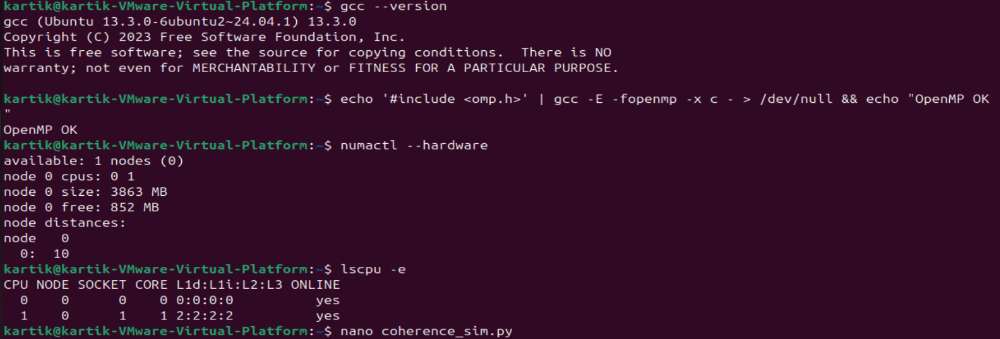

The first VM showed only one NUMA node, so the `.vmx` settings of step 19 were applied. Afterwards `numactl --hardware` reported
two nodes (node 0: CPUs 0-1, 1966 MB; node 1: CPUs 2-3, 1950 MB; distances 10 local / 20 remote).

## 6. Programs and Compilation

Each program demonstrates one part of the example. Program 1 compares the three coherence protocols using the two-counter trace.
Programs 2 and 3 measure false sharing and NUMA memory access on the real machine. All sources are in [`src/`](src/).

### 6.1 Program 1 - Protocol Simulator (MSI, MESI, MOESI)
The simulator models two cores and runs this trace many times: core 0 reads and writes `x`, then core 1 reads and writes `y`.
With the adjacent layout `x` and `y` share cache line A; with the padded layout they use lines A and B. It prints the line states
after each operation and counts bus transactions, write-backs to memory and cache-to-cache transfers.

```bash
python3 coherence_sim.py 1000
```

<details>
<summary>Show <code>coherence_sim.py</code></summary>

```python
#!/usr/bin/env python3
"""Tiny 2-core snooping-cache simulator: MSI vs MESI vs MOESI.

Example workload: two counters x and y. Core 0 does x = x + 1 (read, write),
core 1 does y = y + 1 (read, write). Layout 'adjacent' puts x and y on the
SAME cache line (false sharing); 'padded' puts them on DIFFERENT lines.

Usage: python3 coherence_sim.py [iterations]   (default 1000)
"""
import sys


def make_cores(n=2):
    return [dict() for _ in range(n)]


def access(proto, caches, core, line, op, st):
    """op is 'R' or 'W'. Updates caches and the stats dict st."""
    me = caches[core]
    s = me.get(line, 'I')
    others = [i for i in range(len(caches)) if i != core]
    holders = [i for i in others if caches[i].get(line, 'I') != 'I']

    if op == 'R':
        if s != 'I':
            return  # read hit
        st['BusRd'] += 1
        new = 'S'
        for i in holders:
            o = caches[i][line]
            if o == 'M':
                if proto == 'MOESI':
                    caches[i][line] = 'O'; st['c2c'] += 1       # owner supplies, no write-back
                else:
                    caches[i][line] = 'S'; st['writeback'] += 1  # flush to memory
            elif o == 'O':
                st['c2c'] += 1                                   # owner keeps supplying
            elif o == 'E':
                caches[i][line] = 'S'
        if not holders and proto in ('MESI', 'MOESI'):
            new = 'E'
        me[line] = new
    else:  # write
        if s == 'M':
            return  # write hit, no bus traffic
        if s == 'E':
            me[line] = 'M'; st['silent E->M'] += 1  # MESI/MOESI only
            return
        if s in ('S', 'O'):
            st['BusUpgr'] += 1
        else:  # s == 'I'
            st['BusRdX'] += 1
        for i in holders:
            o = caches[i][line]
            if o in ('M', 'O'):
                if proto == 'MOESI':
                    st['c2c'] += 1
                else:
                    st['writeback'] += 1
        for i in holders:
            caches[i][line] = 'I'; st['invalidations'] += 1
        me[line] = 'M'


def run(proto, layout, iters):
    st = dict.fromkeys(['BusRd', 'BusRdX', 'BusUpgr', 'silent E->M',
                        'invalidations', 'writeback', 'c2c'], 0)
    caches = make_cores()
    lx, ly = ('A', 'A') if layout == 'adjacent' else ('A', 'B')
    trace = []
    for _ in range(iters):
        trace += [(0, lx, 'R'), (0, lx, 'W'), (1, ly, 'R'), (1, ly, 'W')]
    log = []
    for core, line, op in trace:
        access(proto, caches, core, line, op, st)
        log.append((core, line, op, caches[0].get('A', 'I'), caches[1].get('A', 'I')))
    st['bus transactions'] = st['BusRd'] + st['BusRdX'] + st['BusUpgr']
    return st, log


if __name__ == '__main__':
    iters = int(sys.argv[1]) if len(sys.argv) > 1 else 1000
    print("State trace, first 2 iterations, adjacent layout (line A: core0 state / core1 state)")
    for proto in ('MSI', 'MESI', 'MOESI'):
        _, log = run(proto, 'adjacent', 2)
        print(f"\n{proto}:")
        for c, l, o, s0, s1 in log:
            print(f"  core{c} {o} -> C0={s0} C1={s1}")
    print(f"\nTotals for {iters} iterations")
    keys = ['bus transactions', 'BusRd', 'BusRdX', 'BusUpgr', 'invalidations',
            'writeback', 'c2c', 'silent E->M']
    print(f"{'layout':9} {'protocol':6} " + " ".join(f"{k:>16}" for k in keys))
    for layout in ('adjacent', 'padded'):
        for proto in ('MSI', 'MESI', 'MOESI'):
            st, _ = run(proto, layout, iters)
            print(f"{layout:9} {proto:6} " + " ".join(f"{st[k]:>16}" for k in keys))
```

</details>

### 6.2 Program 2 - False Sharing (Adjacent vs Padded)

<details>
<summary>Show <code>false_sharing.c</code></summary>

```c
/* Program 2 - False sharing: adjacent vs padded counters.
 * Compile: gcc -O2 false_sharing.c -fopenmp -o false_sharing
 * Run    : OMP_NUM_THREADS=2 ./false_sharing adjacent|padded
 */
#include <stdio.h>
#include <stdlib.h>
#include <string.h>
#include <omp.h>
#define N 100000000L
int main(int argc, char **argv) {
    int stride = (argc > 1 && argv[1][0] == 'p') ? 8 : 1; /* p = padded: 8 longs = 64 bytes */
    int nt = omp_get_max_threads();
    size_t bytes = ((size_t)nt * stride * sizeof(long) + 63) / 64 * 64;
    long *cnt = aligned_alloc(64, bytes);
    memset(cnt, 0, bytes);
    double t0 = omp_get_wtime();
    #pragma omp parallel
    {
        volatile long *p = &cnt[omp_get_thread_num() * stride];
        for (long i = 0; i < N / nt; i++) (*p)++; /* read-modify-write own counter */
    }
    double t = omp_get_wtime() - t0;
    long total = 0;
    for (int i = 0; i < nt; i++) total += cnt[i * stride];
    printf("%s | threads=%d | total=%ld | time=%.4f s\n",
           stride == 1 ? "adjacent" : "padded ", nt, total, t);
    return 0;
}
```

</details>

Compile:
```bash
gcc -O2 false_sharing.c -fopenmp -o false_sharing
```
Run (set the thread count with `OMP_NUM_THREADS`; argument `adjacent` or `padded`):
```bash
OMP_NUM_THREADS=2 ./false_sharing adjacent
OMP_NUM_THREADS=2 ./false_sharing padded
```

### 6.3 Program 3 - NUMA Memory Sweep

<details>
<summary>Show <code>numa_sweep.c</code></summary>

```c
/* Program 3 - NUMA memory sweep.
 * Compile: gcc -O2 numa_sweep.c -fopenmp -o numa_sweep
 * Run    : OMP_NUM_THREADS=2 numactl --cpunodebind=0 --membind=0 ./numa_sweep   (local)
 *          OMP_NUM_THREADS=2 numactl --cpunodebind=0 --membind=1 ./numa_sweep   (remote)
 */
#include <stdio.h>
#include <stdlib.h>
#include <string.h>
#include <omp.h>
int main(int argc, char **argv) {
    size_t mb = argc > 1 ? atol(argv[1]) : 512;
    size_t n = mb << 20;
    char *buf = malloc(n);
    memset(buf, 1, n); /* first touch: pages are placed by the numactl policy */
    long sum = 0;
    double t0 = omp_get_wtime();
    for (int pass = 0; pass < 4; pass++) {
        #pragma omp parallel for reduction(+:sum)
        for (size_t i = 0; i < n; i += 64) /* one read per 64-byte cache line */
            sum += buf[i];
    }
    printf("buffer=%zu MB | threads=%d | sum=%ld | time=%.4f s\n",
           mb, omp_get_max_threads(), sum, omp_get_wtime() - t0);
    return 0;
}
```

</details>

Compile:
```bash
gcc -O2 numa_sweep.c -fopenmp -o numa_sweep
```
Run local, then remote (replace the node numbers with the ones shown by `numactl --hardware`):
```bash
OMP_NUM_THREADS=2 numactl --cpunodebind=0 --membind=0 ./numa_sweep
OMP_NUM_THREADS=2 numactl --cpunodebind=0 --membind=1 ./numa_sweep
```

## 7. Comparison Program - Scalability & Execution Time

Program 4 combines Programs 2 and 3 in one benchmark. **Table 1** repeats the same 100,000,000-increment workload for the adjacent
and padded layouts with 1, 2 and 4 threads, checking the final total against the expected value. **Table 2** times the 512 MB
memory sweep with 1 and 2 threads. Run it normally, then under `numactl` with local and remote memory (Section 8). This single
program produces the data used in Sections 9 and 10.

<details>
<summary>Show <code>compare_numa.c</code></summary>

```c
/* compare_numa.c  (Program 4 - comparison program)
 * Table 1: two-counter example, adjacent vs padded layout, 1/2/4 threads.
 * Table 2: memory sweep of a 512 MB buffer, 1/2 threads (run under numactl).
 * Compile: gcc -O2 compare_numa.c -fopenmp -o compare_numa
 * Run    : ./compare_numa
 */
#include <stdio.h>
#include <stdlib.h>
#include <string.h>
#include <omp.h>
#define N 100000000L
#define MB 512UL

double run_counters(int nt, int stride, long *total) {
    size_t bytes = ((size_t)nt * stride * sizeof(long) + 63) / 64 * 64;
    long *cnt = aligned_alloc(64, bytes);
    memset(cnt, 0, bytes);
    omp_set_num_threads(nt);
    double t0 = omp_get_wtime();
    #pragma omp parallel num_threads(nt)
    {
        volatile long *p = &cnt[omp_get_thread_num() * stride];
        for (long i = 0; i < N / nt; i++) (*p)++;
    }
    double t = omp_get_wtime() - t0;
    *total = 0;
    for (int i = 0; i < nt; i++) *total += cnt[i * stride];
    free(cnt);
    return t;
}

double run_sweep(char *buf, size_t n, int nt) {
    long sum = 0;
    omp_set_num_threads(nt);
    double t0 = omp_get_wtime();
    for (int pass = 0; pass < 4; pass++) {
        #pragma omp parallel for reduction(+:sum)
        for (size_t i = 0; i < n; i += 64) sum += buf[i];
    }
    double t = omp_get_wtime() - t0;
    if (sum == 0) printf("unexpected\n");
    return t;
}

int main(void) {
    int tc[] = {1, 2, 4};
    printf("Table 1: false sharing (%ld increments in total)\n", N);
    printf("Layout   | Threads | Final Count | Correctness | Time (s)\n");
    printf("---------------------------------------------------------\n");
    for (int i = 0; i < 3; i++) {
        for (int s = 1; s <= 8; s *= 8) {
            long total;
            double t = run_counters(tc[i], s, &total);
            printf("%-8s | %7d | %11ld | %-11s | %8.4f\n", s == 1 ? "adjacent" : "padded",
                   tc[i], total, total == N ? "Correct" : "INCORRECT", t);
        }
    }
    printf("---------------------------------------------------------\n");
    size_t n = MB << 20;
    char *buf = malloc(n);
    memset(buf, 1, n); /* first touch decides the NUMA node */
    printf("\nTable 2: memory sweep of %lu MB (4 passes)\n", MB);
    printf("Threads | Time (s)\n");
    printf("-------------------\n");
    for (int i = 0; i < 2; i++) printf("%7d | %8.4f\n", tc[i], run_sweep(buf, n, tc[i]));
    return 0;
}
```

</details>

Compile and run:
```bash
gcc -O2 compare_numa.c -fopenmp -o compare_numa
./compare_numa
```

## 8. Execution Steps (Terminal)

| Step | Command | Purpose |
|---|---|---|
| 1 | `sudo apt update && sudo apt install build-essential numactl hwloc python3 -y` | Install GCC, the OpenMP runtime, numactl and Python |
| 2 | `numactl --hardware ; lscpu -e` | List NUMA nodes and which CPU numbers belong to each |
| 3 | `nano coherence_sim.py` (repeat for each source file) | Create or paste each program's source code |
| 4 | `python3 coherence_sim.py 1000` | Part A: run the MSI / MESI / MOESI simulation |
| 5 | `gcc -O2 false_sharing.c -fopenmp -o false_sharing` | Compile Program 2 |
| 6 | `gcc -O2 numa_sweep.c -fopenmp -o numa_sweep` | Compile Program 3 |
| 7 | `gcc -O2 compare_numa.c -fopenmp -o compare_numa` | Compile the comparison program |
| 8 | `OMP_NUM_THREADS=2 ./false_sharing adjacent` and `OMP_NUM_THREADS=2 ./false_sharing padded` | Part B1: false sharing with 2 threads (repeat 3 times) |
| 9 | `./compare_numa` | Tables 1 and 2 with default placement |
| 10 | `numactl --cpunodebind=0 --membind=0 ./compare_numa` | Part B2: threads and memory on node 0 (local) |
| 11 | `numactl --cpunodebind=0 --membind=1 ./compare_numa` | Part B2: threads on node 0, memory on node 1 (remote) |
| 12 | `OMP_NUM_THREADS=2 taskset -c 0,2 ./false_sharing adjacent` | Optional: one thread on each node (use CPU numbers from step 2) |

Run each configuration three times and keep the median time. Choose CPUs on different physical cores, and close other programs so
that the VM stays idle. You can also set the thread count as an environment variable before running any OpenMP program:
```bash
export OMP_NUM_THREADS=4
./false_sharing padded
```
`src/run_all.sh` runs steps 2 to 11 in one go, and `src/analyze_results.py` regenerates all graphs from `data/`.

## 9. Results

> Timing values depend on the machine, the VM and the number of cores. The values below were measured in this run (one run per
> configuration; see [Section 12](#12-experimental-notes-and-limitations)). Raw CSV files are in [`data/`](data/) and the terminal
> screenshots are in [`results/screenshots/`](results/screenshots/).

### 9.1 Part A: Protocol Simulation (actual output of Program 1)

State of cache line A in core 0 / core 1 after each operation, first two iterations, adjacent layout:

| Operation | MSI (C0 / C1) | MESI (C0 / C1) | MOESI (C0 / C1) |
|---|---|---|---|
| core 0 reads its counter | S / I | E / I | E / I |
| core 0 writes its counter | M / I | M / I | M / I |
| core 1 reads its counter | S / S | S / S | O / S |
| core 1 writes its counter | I / M | I / M | I / M |
| core 0 reads its counter | S / S | S / S | S / O |
| core 0 writes its counter | M / I | M / I | M / I |
| core 1 reads its counter | S / S | S / S | O / S |
| core 1 writes its counter | I / M | I / M | I / M |

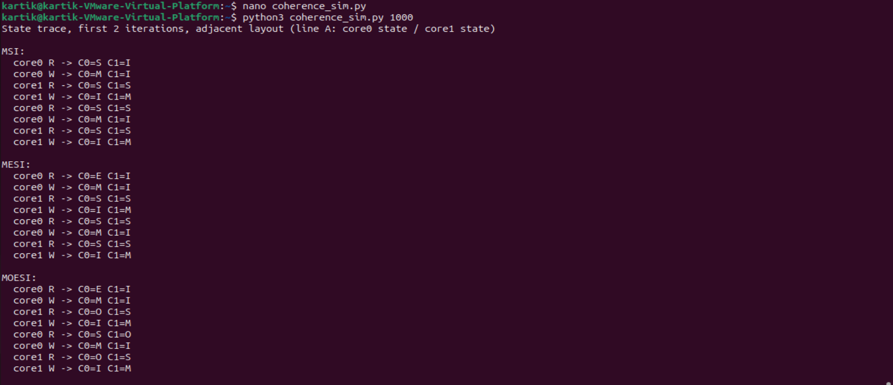

Totals for 1000 iterations (4000 memory operations):

| Layout | Protocol | Bus tx | BusRd | RdX | Upgr | Inval. | WB | C2C | Silent E-M |
|---|---|---|---|---|---|---|---|---|---|
| adjacent | MSI | 4000 | 2000 | 0 | 2000 | 1999 | 1999 | 0 | 0 |
| adjacent | MESI | 3999 | 2000 | 0 | 1999 | 1999 | 1999 | 0 | 1 |
| adjacent | MOESI | 3999 | 2000 | 0 | 1999 | 1999 | 0 | 3998 | 1 |
| padded | MSI | 4 | 2 | 0 | 2 | 0 | 0 | 0 | 0 |
| padded | MESI | 2 | 2 | 0 | 0 | 0 | 0 | 0 | 2 |
| padded | MOESI | 2 | 2 | 0 | 0 | 0 | 0 | 0 | 2 |

*Bus tx = BusRd + RdX + Upgr. RdX = BusRdX (write miss). Upgr = BusUpgr (write to a shared line). Inval. = copies invalidated.
WB = forced write-back to memory. C2C = cache-to-cache transfers. Silent E-M = writes needing no bus transaction.*

> The manual's sample table lists MOESI C2C as 1999. The simulator run in this experiment reports **3998** (it counts the supply
> of the line on reads and on invalidating writes), so the measured value is used here. All other values match the manual.

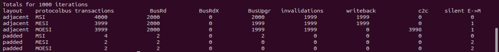

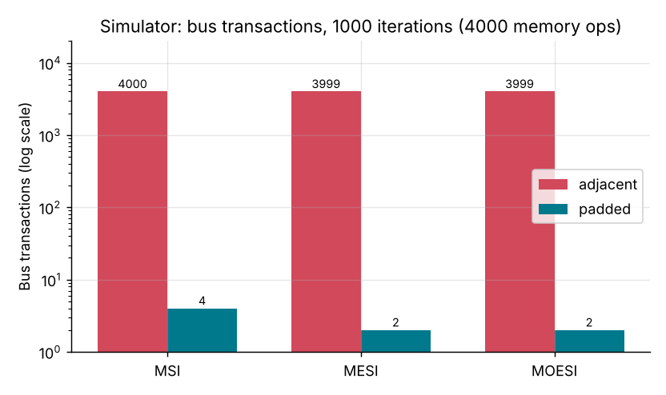

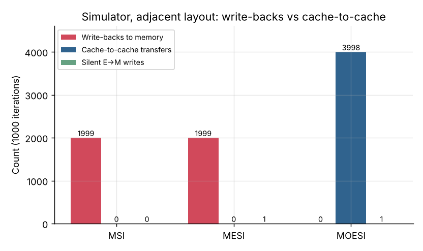

**Reading the simulation.**
- With the adjacent layout all three protocols need about 4000 bus transactions for 4000 memory operations: the line ping-pongs
  between the cores, and MESI saves only the single first upgrade (3999 vs 4000).
- With the padded layout MESI and MOESI need 2 transactions against 4 for MSI, because the private line goes E to M silently.
- MOESI removes all 1999 write-backs to memory that MSI and MESI perform, replacing them with cache-to-cache transfers.

### 9.2 Part B: Output of the Programs

**Program 2 (false sharing, 2 threads):**

```
adjacent | threads=2 | total=100000000 | time=0.0185 s
padded   | threads=2 | total=100000000 | time=0.0151 s
```
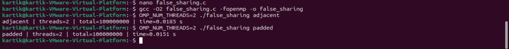

**Program 3 (NUMA sweep, 2 threads).** The first attempt on the 1-node VM ran the local case (0.0961 s) and rejected
`--membind=1` ("node argument 1 is out of range"). After enabling virtual NUMA (2 nodes) both cases ran:

```
local  (cpunodebind=0, membind=0): buffer=512 MB | threads=2 | sum=33554432 | time=0.0977 s
remote (cpunodebind=0, membind=1): buffer=512 MB | threads=2 | sum=33554432 | time=0.0978 s
```
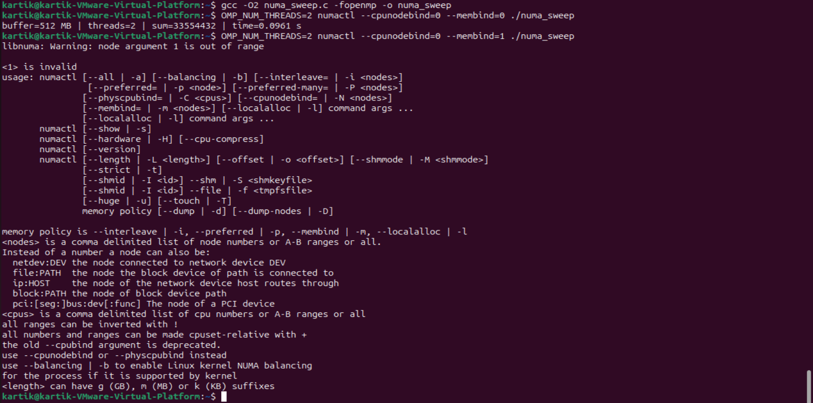
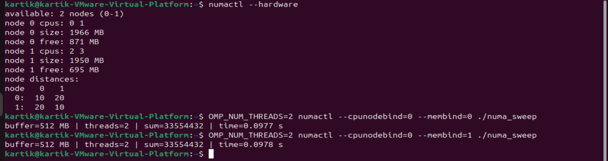

**Program 4 (`compare_numa`), default placement:**

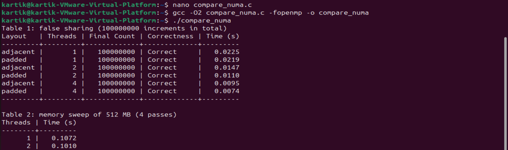

**Program 4 under numactl (local, then remote):**

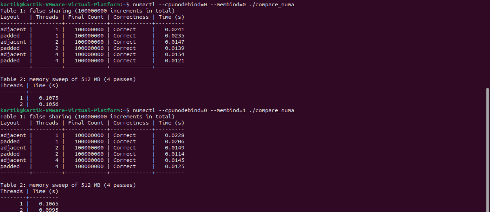

#### Table 1: False sharing, 100,000,000 increments (time in seconds)

All 18 runs produced Final Count = 100000000 (**Correct**).

| Run | Threads | Adjacent | Padded | Adjacent / Padded | Speed-up adjacent | Speed-up padded |
|---|---|---|---|---|---|---|
| default | 1 | 0.0225 | 0.0219 | 1.03 | 1.00 | 1.00 |
| default | 2 | 0.0147 | 0.0110 | 1.34 | 1.53 | 1.99 |
| default | 4 | 0.0095 | 0.0074 | 1.28 | 2.37 | 2.96 |
| local | 1 | 0.0241 | 0.0235 | 1.03 | 1.00 | 1.00 |
| local | 2 | 0.0147 | 0.0139 | 1.06 | 1.64 | 1.69 |
| local | 4 | 0.0154 | 0.0121 | 1.27 | 1.56 | 1.94 |
| remote | 1 | 0.0228 | 0.0206 | 1.11 | 1.00 | 1.00 |
| remote | 2 | 0.0149 | 0.0114 | 1.31 | 1.53 | 1.81 |
| remote | 4 | 0.0145 | 0.0125 | 1.16 | 1.57 | 1.65 |

*Speed-up = 1-thread time / n-thread time for the same layout and run.*

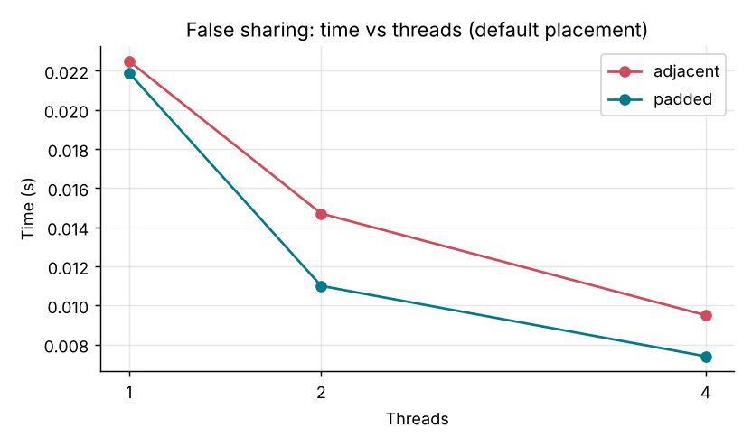

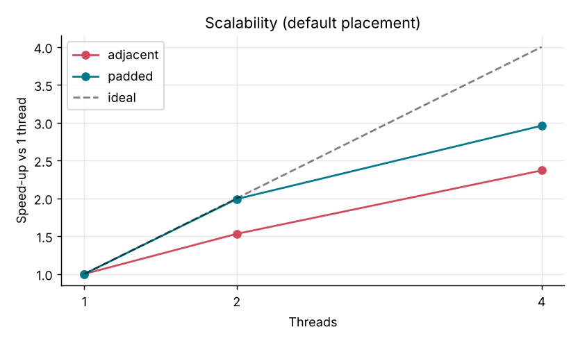

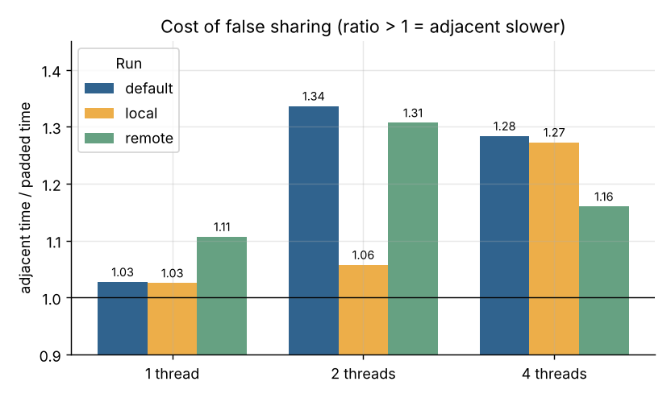

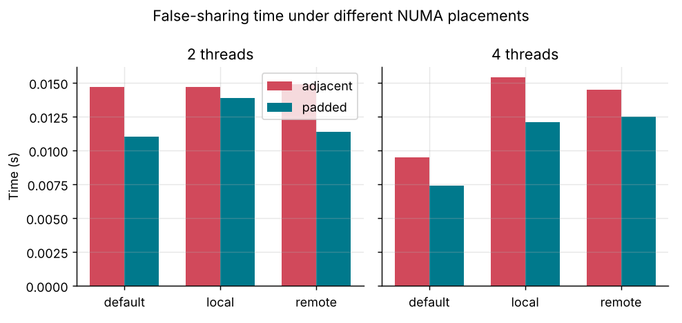

#### Table 2: Memory sweep of 512 MB, 4 passes (time in seconds)

| Threads | Default | Local (`--membind=0`) | Remote (`--membind=1`) | Remote / Local |
|---|---|---|---|---|
| 1 | 0.1072 | 0.1075 | 0.1065 | 0.99 |
| 2 | 0.1010 | 0.1056 | 0.0995 | 0.94 |

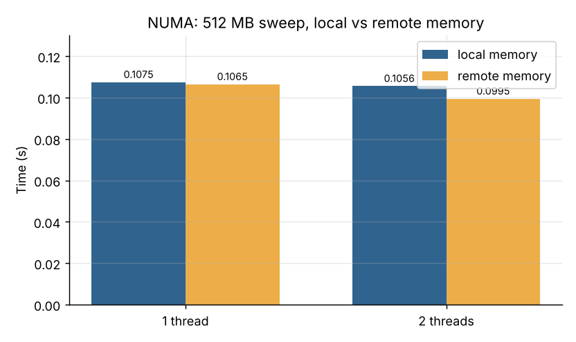

### 9.3 Results to Record

| Run | Time (s) |
|---|---|
| adjacent, 2 threads (Program 2) | 0.0185 |
| padded, 2 threads (Program 2) | 0.0151 |
| Table 2, memory LOCAL (`--membind=0`), 1 thread | 0.1075 |
| Table 2, memory LOCAL (`--membind=0`), 2 threads | 0.1056 |
| Table 2, memory REMOTE (`--membind=1`), 1 thread | 0.1065 |
| Table 2, memory REMOTE (`--membind=1`), 2 threads | 0.0995 |
| adjacent, one thread on each node (optional) | not run |

**Ratios**

| Ratio | Value |
|---|---|
| adjacent / padded, Program 2 (2 threads): 0.0185 / 0.0151 | **1.23** |
| adjacent / padded, `compare_numa` default (1 / 2 / 4 threads) | **1.03 / 1.34 / 1.28** |
| remote / local, Program 3 (2 threads): 0.0978 / 0.0977 | **1.00** |
| remote / local, Table 2 (1 thread / 2 threads) | **0.99 / 0.94** |

## 10. Observation / Comparison Table

| Case | Correctness | Relative performance (expected) | Relative performance (measured) | Scalability (measured) |
|---|---|---|---|---|
| MSI (simulated) | Correct | More bus traffic: even a private line needs an upgrade before its first write | 4000 tx adjacent; 4 tx padded | Same traffic growth as MESI when lines are shared |
| MESI (simulated) | Correct | Fewer transactions for private data (silent E to M) | 3999 tx adjacent; 2 tx padded | Good for private data, same ping-pong on shared lines |
| MOESI (simulated) | Correct | No forced write-back to memory; owner supplies the line cache to cache | 0 write-backs (1999 in MSI/MESI); 3998 cache-to-cache transfers | Lowest memory traffic of the three |
| Adjacent counters (false sharing) | Correct | Typically slower: the line bounces between cores | Slower than padded in all multi-thread runs (ratio 1.06 to 1.34); effect modest in the VM | Speed-up 1.53x (2 thr), 2.37x (4 thr) in the default run |
| Padded counters | Correct | Typically fastest: each core keeps its line in M | 0.0110 s (2 thr), 0.0074 s (4 thr) in the default run | Speed-up 1.99x (2 thr), 2.96x (4 thr) in the default run |
| Local memory (NUMA) | Correct | Reference time for the memory sweep | 0.1075 s (1 thr), 0.1056 s (2 thr) | Almost flat from 1 to 2 threads |
| Remote memory (NUMA) | Correct | Typically slower on a multi-socket machine; about equal on a single-socket PC | 0.1065 s (1 thr), 0.0995 s (2 thr): no penalty in the VM | Almost flat from 1 to 2 threads |

## 11. Conclusion

All three protocols keep the caches correct; they differ in how much bus traffic they need. The simulation shows that MESI saves
the upgrade transaction for data that only one core uses (4 to 2 transactions in the padded layout), and that MOESI avoids
writing a dirty line back to memory when another core reads it (1999 write-backs to 0), by letting the owner supply the line
directly.

The two-counter example shows that coherence works on whole cache lines: when two independent counters share a line, the line
ping-pongs between the cores, which is false sharing, and padding the counters onto separate lines removes this cost. In the
measurements every counter run was correct, padded counters were faster than adjacent counters in every multi-thread run (up to
1.34x), and the padded layout scaled better in the default run (2.96x vs 2.37x on 4 threads). The effect was modest because the
experiment ran in a VM with short timed regions.

NUMA adds a second effect: memory attached to another node is slower to reach, so threads and their memory should be placed on the
same node (`numactl --cpunodebind` and `--membind`, or first-touch allocation). In this run local and remote memory gave equal
times (remote / local = 1.00 to 0.94), as expected, because both virtual nodes are backed by the same physical memory; a real
remote-memory penalty needs a multi-socket machine. The choice of data layout and placement therefore matters as much as the
choice of protocol for the scalability of a parallel program.

## 12. Experimental Notes and Limitations

- **Environment:** VMware Workstation guest, Ubuntu 24.04 (the manual specifies 22.04), gcc 13.3.0, 4 vCPUs, two virtual NUMA nodes
  (node 0 = CPUs 0-1, node 1 = CPUs 2-3, distance 10 / 20). Details in [`data/system_info.txt`](data/system_info.txt).
- **Single run per configuration.** The manual asks for the median of three runs. Each timed region is only about 7 to 25 ms, so
  differences of a few percent are within noise (for example the 1-thread adjacent/padded ratio reaches 1.11 although no sharing exists).
- **4-thread runs under `numactl --cpunodebind=0` are oversubscribed:** node 0 holds only CPUs 0-1, so four threads share two vCPUs.
  Their times therefore do not improve over 2 threads and do not measure scaling.
- **Modest false-sharing penalty (1.1x to 1.3x)** compared with the several-fold slowdowns often seen on bare metal. Possible
  contributors, not verified here: vCPUs sharing a physical core or cache, very short runtimes, and fast store-to-load forwarding on recent CPUs.
- **No NUMA penalty is expected in a VM** because both virtual nodes use the same physical memory. Remote being slightly faster in
  Table 2 is noise.
- The optional one-thread-per-node run (`taskset -c 0,2`) was not performed.
- The manual's MOESI C2C value (1999) differs from the simulator output (3998); the measured value is reported.

## 13. Repository Structure

```
.
├── README.md                this file
├── data/                    raw measurements (CSV) and system_info.txt
├── graphs/                  PNG graphs used in this README
├── report/                  Experiment_Report.pdf and the original Experiment_Manual.pdf
├── results/                 results_summary.md, raw_terminal_output.txt, screenshots/
└── src/                     coherence_sim.py, false_sharing.c, numa_sweep.c, compare_numa.c,
                             Makefile, run_all.sh, analyze_results.py
```
